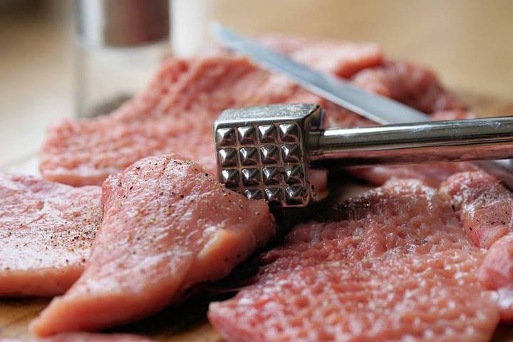

<!-- Recipe body. Text from Toprecepty.cz is VERBATIM — do not rewrite. Our additions only inside ::: our-tip / ::: note / ::: warning. Format: docs/CONTENT-FORMAT.md -->

Klasikou českých Vánoc a nedělních obědů je křupavý kuřecí řízek v trojobalu. Pokud s vařením teprve začínáte a nejste si s postupem přípravy jistí, vyzkoušejte tento jednoduchý recept, podle kterého se vám řízky jistě povedou.

## Suroviny

- **500 g** kuřecího masa (prsní nebo stehenní)
- sůl
- mletý pepř
- hladká mouka
- strouhanka
- **2** vejce
- **100 ml** mléka
- olej na smažení

## Postup

### 1. Příprava masa

Maso nakrájíme na plátky. Poté ho z obou stran osolíme a opepříme.

### 2. Příprava obalovacích směsí

Připravíme 3 hluboké talíře. Do prvního vsypeme hladkou mouku, do druhého rozklepneme dvě nevařená vajíčka bez skořápky, přidáme mléko, špetku soli, trochu pepře a pořádně promícháme. Do třetího talíře nasypeme strouhanku.

::: note
Tomuhle pořadí (mouka → vejce → strouhanka) se říká **trojobal**.
:::

### 3. Obalování řízků

Maso důkladně obalíme z obou stran v prvním talíři, pak ve druhém a nakonec ve třetím.

### 4. Dvojité obalování

Pro lepší konzistenci obalu je dobré postupovat tak, že obalíme v prvním, pak v druhém, pak zase prvním, zase v druhém a nakonec ve třetím talíři.

### 5. Smažení

Na pánev nalijeme dostatečné množství oleje, rozpálíme ho a řízky osmažíme.

::: our-tip
Bez pánve to jde i v horkovzdušné fritéze — postup je níže v tipu „Varianta · horkovzdušná fritéza“. Jak poznat, že je maso hotové, najdete v tipu „Je řízek hotový?“.
:::

::: warning
Rozpálený olej může vzplanout. Nikdy ho nehaste vodou — pánev přikryjte pokličkou a vypněte plyn.
:::

## Tipy

::: tip Varianta · horkovzdušná fritéza
- **180 °C** teplota
- **20 min** doba
- **v ½** obrátit

Připravené, již obalené řízky nejprve potřete z obou stran olejem – použít můžete mašlovačku nebo olej ve spreji přímo k tomuto určený.

Omaštěné řízky vložte do horkovzdušné fritézy a smažte při 180 °C po dobu 20 minut. V polovině doby je obraťte, aby byly zlatavé a křupavé z obou stran.

— Zdroj: [Toprecepty.cz — Jak udělat řízek v horkovzdušné fritéze?](https://www.toprecepty.cz/tipy-triky/jak-pripravit-rizek-v-horkovzdusne-friteze/) (Kristýna Anna Vondálová)
:::

::: our-tip Je řízek hotový?
> bílé uvnitř

Řízek rozkrojte v nejsilnějším místě: maso musí být uvnitř **bílé, bez růžové barvy**, a šťáva čirá. Když je ještě růžové, smažte dál.

Máte-li **ruční vpichový teploměr**, zapíchněte ho z boku do středu plátku — hotové kuřecí maso má v jádru aspoň **74 °C**.

Sondu do masa z naší trouby tady použít nejde: je připojená k troubě a funguje jen při pečení v troubě — ne na pánvi ani ve fritéze.
:::

## Zdroj

**Varianta pro fritézu:** [Toprecepty.cz — tipy a triky](https://www.toprecepty.cz/tipy-triky/jak-pripravit-rizek-v-horkovzdusne-friteze/) (Kristýna Anna Vondálová).
